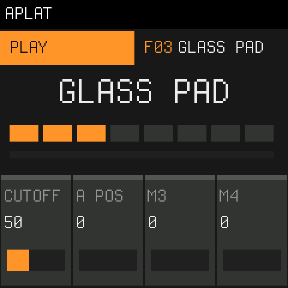
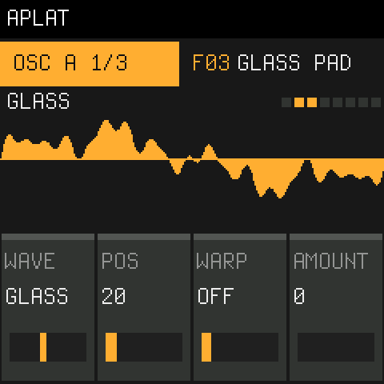
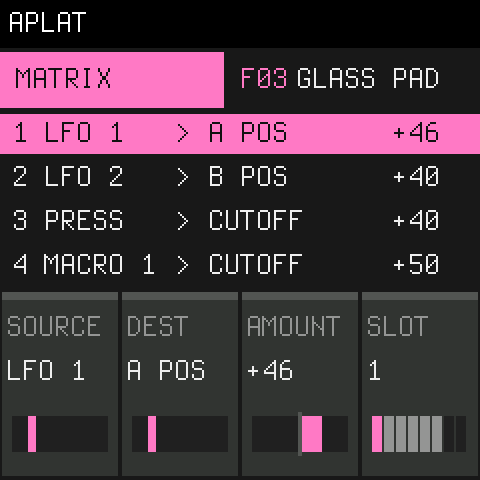

# APLAT

A wavetable synthesizer for the M-VAVE FM-1, free and open source (GPL-3.0). It runs on
[fm1-dock](https://github.com/joakimeriksson/fm1-dock): as one more synth in a dock you already have, or as a
firmware of its own.

Every note is a whole synth: its own filter, its own three envelopes, its own two LFOs and its own pass through the
modulation matrix. So the velocity of a key, and the pressure on it, shape that note alone.

<p>
  
  
  
  
</p>

The screen is flat blocks of colour, one colour per section: the page on its colour at the top, a picture of what
the page edits, and four tiles, one for each knob. [All 24 pages](docs/pages.png).

> **Status: 0.1, not yet played on a real FM-1.** It was written and tested on a computer: the module's own code,
> unchanged, on a stand-in for fm1-dock's host ([Tests](#tests)). Building it for the FM-1 needs JieLi's
> compiler, which GitHub's build does ([Build](#build)). What only the unit can tell is still open: the time a
> block of sound takes on the real chip, and how it sounds through its output. Read
> [Before you release](#before-you-release) first.

## What it has

- **Eight notes**, fewer for a heavy sound: unison, a stereo filter or a 24 dB filter cost time, and a sound gets
  the notes its cost leaves (VOICE shows how many). If the chip still runs short, APLAT lets the oldest note go
  rather than be stopped by the dock.
- **Two wavetable oscillators**: 24 tables of 8 frames, all made for APLAT ([tools/gen_tables.py](tools/gen_tables.py)),
  a position that moves smoothly through the frames, and a warp: SYNC, BEND +, BEND -, PWM, MIRROR, FM (A by B,
  B by the sub) or QUANT. Up to 5 unison voices each, with detune and stereo spread. No harmonic passes half the
  sample rate: each frame is kept at 12 levels, half an octave apart.
- **A sub** (sine, triangle, square, saw; through the filter or straight out) and **noise** (white, pink, dark,
  or TUNED, which follows the keys).
- **A filter for every note**: LP 12, LP 24, band-pass, HP 12, notch; drive into it; cutoff from the key, the
  velocity, envelope 2 and LFO 1 without using a matrix slot.
- **Three envelopes and two LFOs for every note** (LFO shapes: sine, triangle, saw, square, S+H, drift; free or
  in time with the tempo; a fade-in), and a third LFO shared by all notes.
- **A matrix of eight slots.** Sources: envelopes 2 and 3, the three LFOs, velocity, key, pressure (of the key
  itself, or channel pressure), wheel, bend, a random number per note, four macros. Destinations: pitch, fine
  pitch, each oscillator's position, warp and level, B's pitch, cutoff, resonance, amp, pan, noise, LFO 1's rate.
- **Effects**: drive (soft, hard, fold, crush), chorus, an echo in time with the tempo, a reverb. A limiter that
  sees 0.7 ms ahead keeps a big chord from clipping.
- **An arpeggiator**: up, down, up-down, random, as played, chord; 1 to 4 octaves, gate, swing, latch. It follows
  TEMPO, or MIDI clock when one comes in (the echo and synced LFOs too).
- **POLY, MONO, LEGATO**, glide, the sustain pedal.
- **23 factory sounds and 32 of your own**; REC compares the edited sound with the stored one.

From fm1-dock under it: the keys' velocity and pressure (its key sensing), USB audio and MIDI, the DIN input,
its effects and EQ, the updater and the rescue.

## The panel

| | |
| --- | --- |
| **SELECT** | the pages, one after the other |
| **PRESETS** | the sounds: F01..F23, then U01..U32 |
| **ALGORITHM** | the wavetable of oscillator A (of B on its pages) |
| **KNOB 1..4** | the four tiles of the page |
| **PLAY** | the PLAY page: the sound's name and four macros (each named after what it moves) |
| **EDIT** | OSC A, then OSC B, then MIX |
| **SEL** | FILTER |
| **ENV** / **LFO** | ENV 1 (the amp), 2, 3 / LFO 1, 2, 3 |
| **SEQ** | MATRIX: knob 4 picks the slot |
| **ARP** | the arpeggiator and TEMPO |
| **FX** | DRIVE and CHORUS, then DELAY, then REVERB |
| **GLO** | VOICE: POLY / MONO / LEGATO, glide, bend range, velocity; the notes allowed and the measured load |
| **REC** | the stored sound and the edited one, by turns |
| **SAVE** | pick a user sound with PRESETS, SAVE again (any other button: no) |

OCT -, OCT + and HOME are fm1-dock's.

## MIDI

Notes with velocity, pitch bend, channel and polyphonic pressure, program change (the sounds in order), clock,
start and stop. Controllers: 1 the wheel, 5 glide, 16..19 the macros, 64 the pedal, 71 resonance, 72 release,
73 attack, 74 cutoff, 75 decay, 91 reverb, 93 chorus, 94 echo, 120 / 123 all notes off.

## Install

Releases carry two files.

- **`aplat.dock`**, for an FM-1 that runs fm1-dock: drop it on the console of
  [fm1-dock's page](https://joakimeriksson.github.io/fm1-dock/#console), then hold HOME and pick APLAT.
- **`aplat-X.Y.fwsc`**, a firmware of its own (fm1-dock with APLAT as its only synth; no Bluetooth MIDI in it):
  install it as any `.fwsc`, for instance with fm1-dock's `tools/fm1_install.py`.

Installing firmware is at your own risk. OCT - held at power-on is fm1-dock's USB rescue; what to do when even
that is gone is in fm1-dock's [docs/RULES.md](https://github.com/joakimeriksson/fm1-dock/blob/main/docs/RULES.md).

**Newer FM-1s** (since autumn 2026) have another flash chip (UC25HQ80, ID 0xB36014). The platform APLAT stands on
knows both chips ([fm1-dock, firmware/hal/fm1_flash.h](https://github.com/joakimeriksson/fm1-dock/blob/main/firmware/hal/fm1_flash.h));
fm1-dock's README says that nobody had run its 1.0 on a newer unit when APLAT was written. Check that saving works
on yours (SAVE a sound, switch off, switch on) before you rely on it.

## Build

On GitHub, nothing to install: push this repository, then run the **release** workflow by hand (Actions, release,
Run workflow) and take `aplat.dock` and `aplat.fwsc` from the run's *packages* artifact. A tag `v0.1` makes the
release `aplat-0.1.fwsc`, built and signed by the Firmware Hub's shared workflow
([zvenson/fm1-build](https://github.com/zvenson/fm1-build)).

On your own computer (Linux x86-64, or Docker): what fm1-dock's build needs, then `./build.sh`. It clones
fm1-dock at the commit APLAT was written against and runs its build with `aplat/` as the module.

## Tests

No FM-1 needed: a C compiler, Python with numpy and Pillow, and a checkout of fm1-dock (its screen code and font
draw the pictures).

```sh
DOCK=/path/to/fm1-dock python3 tests/run_tests.py     # the module on host/host.c, with the sanitizers
DOCK=/path/to/fm1-dock python3 tools/precheck.py      # what fm1-dock's build will refuse, tried on a 32-bit RISC-V
DOCK=/path/to/fm1-dock python3 tools/load/count.py    # instructions a block of sound takes (pip install unicorn)
python3 tools/demo.py > build/demo.txt && DOCK=/path/to/fm1-dock host/run.sh build/demo.txt build/demo
```

`run_tests.py` checks the tuning (within 0.1 cent from C1 to C8), that a high note carries nothing but its
harmonics (-48 dB or better), every factory sound (it sounds, it never clips, it ends, no note hangs), the trade
of unison for notes, the guard that lets notes go on a slow chip, legato and glide, the arpeggiator's rate from
TEMPO and from MIDI clock, every page of the screen, saving and comparing, and two minutes of random knobs,
buttons, MIDI and notes on random sounds.

`count.py` gives an estimate, not a measurement: on a 32-bit RISC-V stand-in a block takes 20 % of its time for
eight plain notes, 30 to 47 % for the factory pads with eight keys held, 53 % for the heaviest sound the panel
can make, counted at the rate fm1-emu uses (an instruction per cycle of 240 MHz). The FM-1's chip is another
instruction set and reads its code through a flash cache. The number that counts is the LOAD line on the VOICE
page of a real unit; `COST_BUDGET` in [aplat/ap_eng.h](aplat/ap_eng.h) is the one place to change if it is off.

## Before you release

1. **Play it on a real FM-1.** The Firmware Hub lists only firmwares tested on one. Look at VOICE's LOAD line
   with the heaviest sounds and eight keys held, and listen for breaks in the sound.
2. **Pick a package identity.** `build.sh` uses `FM-1_961`, which is a guess that it is free: two firmwares with
   the same identity look like one to the installers. Look at the hub's list, ask there, and set
   `APLAT_IDENTITY` (or change the default in `build.sh`).
3. Put your name in the copyright lines (`aplat/aplat.c`, `LICENSING.md`).
4. Release with a tag, then ask the hub ([its *Your firmware* card](https://thefirmwarehub.com/)).

## Not there yet

A sequencer (SEQ opens the matrix for now). Naming a user sound on the unit. An editor on a computer, wavetables
of your own, and import from other synths. The second core, which could play half the notes. The inner loops in
RAM beside the flash cache (`.ram_text`), if the measured load asks for it. The M-Vave SMK-37 as a firmware of its
own (as a `.dock` in fm1-dock it should run there too; untested).

## Licence and credits

GPL-3.0-only, see [LICENSE](LICENSE) and [LICENSING.md](LICENSING.md). APLAT is a module for
[fm1-dock](https://github.com/joakimeriksson/fm1-dock) by Joakim Eriksson, on the platform of
[Felucca / Dinghy](https://github.com/hugelton/Felucca) by Leo Kuroshita (Hügelton Instruments) and
[SLOOP](https://github.com/isod89/sloop-fm1) by isod89. It is not made, sold or supported by M-VAVE; M-VAVE and
FM-1 are the trademarks of their owners.
