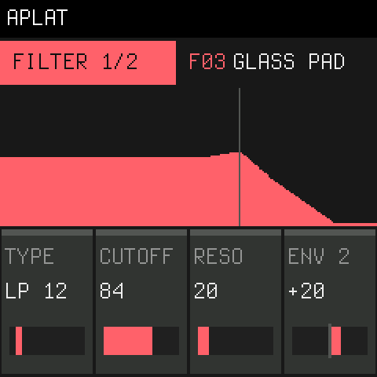
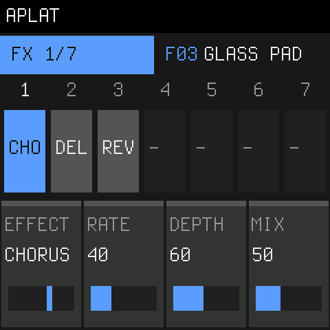
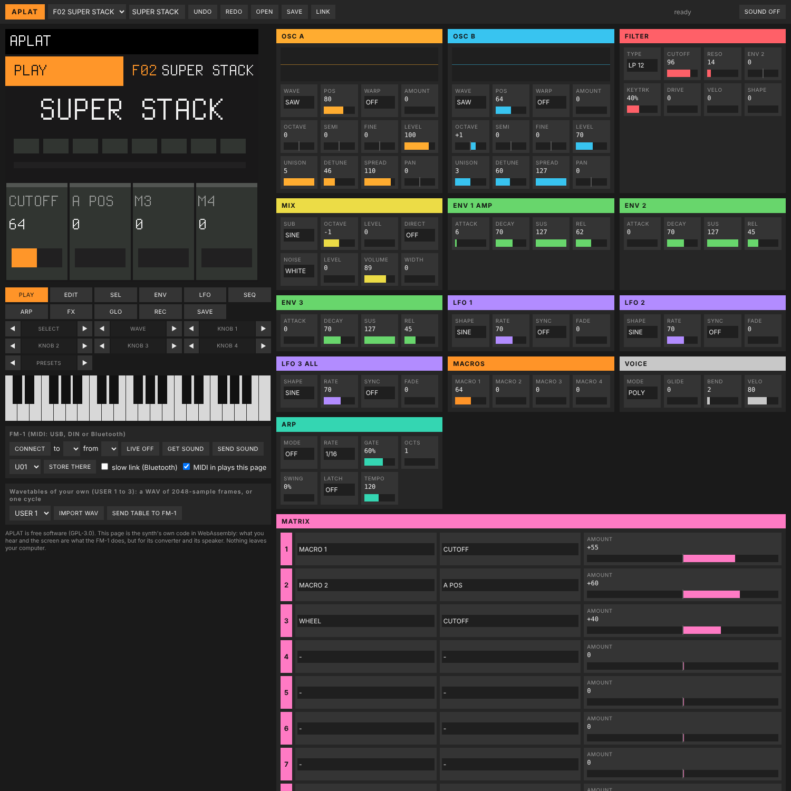

# APLAT

A wavetable synthesizer for the M-VAVE FM-1, free and open source (GPL-3.0), with an editor that runs in a browser.
It runs on [fm1-dock](https://github.com/joakimeriksson/fm1-dock): as one more synth in a dock you already have, or
as a firmware of its own, Bluetooth MIDI included.

Every note is a whole synth: its own filter, its own three envelopes, its own two LFOs and its own pass through the
modulation matrix. So the velocity of a key, and the pressure on it, shape that note alone.

<p>
  
  
  
  
  
</p>

The screen is flat blocks of colour, one colour per section: the page on its colour at the top, a picture of what
the page edits, and four tiles, one for each knob. [All 28 pages](docs/pages.png).

> **Status: 0.2, not yet played on a real FM-1.** It was written and tested on a computer: the module's own code,
> unchanged, on a stand-in for fm1-dock's host ([Tests](#tests)), and in the editor, where you can play it now.
> Building it for the FM-1 needs JieLi's compiler, which GitHub's build does ([Build](#build)). What only the unit
> can tell is still open: the time a block of sound takes on the real chip, how it sounds through its output, and
> Bluetooth. Read [Before you release](#before-you-release) first.

## What it has

- **Eight notes**, fewer for a heavy sound: unison, a stereo or a two-stage filter and the effects cost time, and a
  sound gets the notes its cost leaves (VOICE shows how many). If the chip still runs short, APLAT lets the oldest
  note go rather than be stopped by the dock.
- **Two wavetable oscillators**: 64 tables of 8 frames, all made for APLAT from formulas
  ([tools/gen_tables.py](tools/gen_tables.py)), and 3 of your own (the editor makes them from a WAV). The position
  moves smoothly through the frames; a warp: SYNC, BEND +, BEND -, PWM, MIRROR, FM (A by B, B by the sub) or QUANT.
  Up to 5 unison voices each, with detune and stereo spread. No harmonic passes half the sample rate: each frame is
  kept at 12 levels, half an octave apart.
- **A sub** (sine, triangle, square, saw; through the filter or straight out) and **noise** (white, pink, dark,
  or TUNED, which follows the keys).
- **A filter for every note, 20 types**: LP 6 / 12 / 18 / 24, LP HOT (it overdrives between its two halves), HP 6 /
  12 / 24, BP 12 / 24, NOTCH, NOTCH 2, PEAK, BAND W (a band of any width), TWIN (two band-passes), VOWEL (CUTOFF
  goes A E I O U), COMB + and COMB - (tuned to the key if you want: a plucked string), DECIM (fewer frames and
  bits) and RING. SHAPE is the second knob of the types that have one. Drive into it; cutoff from the key, the
  velocity and envelope 2 without using a matrix slot.
- **Three envelopes and two LFOs for every note** (LFO shapes: sine, triangle, saw, square, S+H, drift; free or
  in time with the tempo; a fade-in), and a third LFO shared by all notes.
- **A matrix of eight slots.** Sources: envelopes 2 and 3, the three LFOs, velocity, key, pressure (of the key
  itself, or channel pressure), wheel, bend, a random number per note, four macros. Destinations: pitch, fine
  pitch, each oscillator's position, warp and level, B's pitch, cutoff, resonance, amp, pan, noise, LFO 1's rate.
- **Seven effect slots, fourteen effects**, in the order you put them: DRIVE, FOLD, CRUSH, COMP, EQ, FILTER (low-pass
  to band-pass to high-pass), PHASER, FLANGER, CHORUS, DIMENS (width without the wobble), TREMOLO (to auto-pan),
  PUMP (ducking on the beat), DELAY (in time with the tempo) and REVERB, three knobs each. After them a limiter
  that sees 0.7 ms ahead keeps a big chord from clipping.
- **An arpeggiator**: up, down, up-down, random, as played, chord; 1 to 4 octaves, gate, swing, latch. It follows
  TEMPO, or MIDI clock when one comes in (the echo, PUMP and synced LFOs too).
- **POLY, MONO, LEGATO**, glide, the sustain pedal.
- **41 factory sounds and 32 of your own**; REC compares the edited sound with the stored one.
- **Every parameter is an NRPN**, in and out: that is how the editor talks to it, over USB, the DIN jack or
  Bluetooth.

From fm1-dock under it: the keys' velocity and pressure (its key sensing), USB audio and MIDI, the DIN input,
Bluetooth MIDI, its effects and EQ, the updater and the rescue.

## The editor

[docs/index.html](docs/index.html) is one file: open it in Chrome or Edge (or serve `docs/` as this repository's
GitHub Pages). The synth inside it is APLAT's own code compiled to WebAssembly, so the page needs no FM-1. If the
browser will not give MIDI to a page opened from a file, serve it: `python3 -m http.server -d docs`, then
`http://localhost:8000`.

<p></p>

- **Play it**: the mouse, the computer's keyboard (A W S E D ... are the keys, Z and X the octave) or any MIDI
  input. The screen on the left is the FM-1's, drawn by the same code, with its buttons and knobs under it.
- **Edit it**: every parameter by section, named and shown as the FM-1 names and shows it. Drag a bar (Shift: finer),
  double-click for its usual value, the wheel or the arrow keys for one step. Undo and redo, 100 steps.
- **Keep it**: Save and Open (a small JSON file, by parameter name), Link (the sound in a web address), and the
  page remembers the sound it had.
- **With an FM-1**: Connect, then *Get sound*, *Send sound* (it is read back and compared), *Store there* (as one of
  the 32 user sounds), or *Live*: every change in the page goes to the FM-1 and every knob turned on the FM-1 comes
  back. Tick *slow link* over Bluetooth.
- **Wavetables of your own**: *Import WAV* takes a file of 2048-sample frames (the usual wavetable format) or a
  single cycle, keeps 8 frames of 64 harmonics as the built-in tables are kept, and plays it at once as USER 1, 2
  or 3. *Send table to FM-1* takes about 3 s over USB; the FM-1 keeps it in flash.

It does not read other synths' sound files, and it does not record to a file: record the page's sound, or the
FM-1's USB audio, with what you have.

## Bluetooth MIDI

fm1-dock has Bluetooth MIDI, in and out, and APLAT gets all its MIDI from fm1-dock: notes, clock and the editor's
NRPNs arrive over Bluetooth as they do over USB, and what the FM-1 sends (its keys, their pressure, the knobs for the
editor) goes out over both.

- **APLAT as `aplat.dock` in fm1-dock**: nothing to do.
- **APLAT as a firmware of its own**: fm1-dock builds such a firmware without its Bluetooth part, to leave the room to
  the synth. APLAT fits beside it, so `build.sh` keeps it in (one line of fm1-dock's build, changed in the checkout
  `build.sh` makes; `APLAT_NO_BLE=1` builds without).

Switch it on: hold HOME, OPTIONS, **BLUETOOTH** ON. The FM-1 then shows up as `FM1-DOCK xxxx`, without pairing.
How each system connects (a Mac in Audio MIDI Setup; Windows needs a bridge) is in
[fm1-dock's README](https://github.com/joakimeriksson/fm1-dock#bluetooth-midi). Chrome's Web MIDI, and so the
editor, sees a Bluetooth FM-1 once the system has connected it.

## The panel

| | |
| --- | --- |
| **SELECT** | the pages, one after the other |
| **PRESETS** | the sounds: F01..F41, then U01..U32 |
| **ALGORITHM** | the wavetable of oscillator A (of B on its pages): 64, then USER 1 to 3 |
| **KNOB 1..4** | the four tiles of the page |
| **PLAY** | the PLAY page: the sound's name and four macros (each named after what it moves) |
| **EDIT** | OSC A, then OSC B, then MIX |
| **SEL** | FILTER (two pages: SHAPE is on the second) |
| **ENV** / **LFO** | ENV 1 (the amp), 2, 3 / LFO 1, 2, 3 |
| **SEQ** | MATRIX: knob 4 picks the slot |
| **ARP** | the arpeggiator and TEMPO |
| **FX** | the first of the seven effect slots; SELECT goes on to the others. Knob 1 picks the effect |
| **GLO** | VOICE: POLY / MONO / LEGATO, glide, bend range, velocity; the notes allowed and the measured load |
| **REC** | the stored sound and the edited one, by turns |
| **SAVE** | pick a user sound with PRESETS, SAVE again (any other button: no) |

OCT -, OCT + and HOME are fm1-dock's.

## MIDI

Notes with velocity, pitch bend, channel and polyphonic pressure, program change (the sounds in order), clock,
start and stop. Controllers: 1 the wheel, 5 glide, 16..19 the macros, 64 the pedal, 71 resonance, 72 release,
73 attack, 74 cutoff, 75 decay, 91 / 93 / 94 the MIX of the reverb, the chorus and the echo (in whatever slot they
are), 120 / 123 all notes off.

**NRPN**: parameter N of the sound is NRPN N (controllers 99 and 98), its value 14 bits (6 and 38): 132
parameters, in the order of `AP_PARAMS` in [aplat/ap_def.h](aplat/ap_def.h). The rest of the list (the name, "send
me everything", store, a table of one's own) is at the top of [aplat/aplat.c](aplat/aplat.c). APLAT sends nothing
until an editor has asked once.

## Install

Releases carry two files.

- **`aplat.dock`**, for an FM-1 that runs fm1-dock: drop it on the console of
  [fm1-dock's page](https://joakimeriksson.github.io/fm1-dock/#console), then hold HOME and pick APLAT.
- **`aplat-X.Y.fwsc`**, a firmware of its own (fm1-dock with APLAT as its only synth, Bluetooth MIDI included):
  install it as any `.fwsc`, for instance with fm1-dock's `tools/fm1_install.py`.

Installing firmware is at your own risk. OCT - held at power-on is fm1-dock's USB rescue; what to do when even
that is gone is in fm1-dock's [docs/RULES.md](https://github.com/joakimeriksson/fm1-dock/blob/main/docs/RULES.md).

**Newer FM-1s** (since autumn 2026) have another flash chip (UC25HQ80, ID 0xB36014). The platform APLAT stands on
knows both chips ([fm1-dock, firmware/hal/fm1_flash.h](https://github.com/joakimeriksson/fm1-dock/blob/main/firmware/hal/fm1_flash.h));
fm1-dock's README says that nobody had run its 1.0 on a newer unit when APLAT was written. Check that saving works
on yours (SAVE a sound, switch off, switch on) before you rely on it.

## Build

On GitHub, nothing to install: push this repository, then run the **release** workflow by hand (Actions, release,
Run workflow) and take `aplat.dock` and `aplat.fwsc` from the run's *packages* artifact. A tag `v0.1` makes the
release `aplat-0.1.fwsc`, built and signed by the Firmware Hub's shared workflow
([zvenson/fm1-build](https://github.com/zvenson/fm1-build)).

On your own computer (Linux x86-64, or Docker): what fm1-dock's build needs, then `./build.sh`. It clones
fm1-dock at the commit APLAT was written against and runs its build with `aplat/` as the module.

## Tests

No FM-1 needed: a C compiler, Python with numpy and Pillow, and a checkout of fm1-dock (its screen code and font
draw the pictures).

```sh
DOCK=/path/to/fm1-dock python3 tests/run_tests.py     # the module on host/host.c, with the sanitizers
DOCK=/path/to/fm1-dock python3 tools/precheck.py      # what fm1-dock's build will refuse, tried on a 32-bit RISC-V
DOCK=/path/to/fm1-dock python3 tools/load/count.py    # instructions a block of sound takes (pip install unicorn)
DOCK=/path/to/fm1-dock python3 tools/build_editor.py  # docs/index.html again (clang with wasm32, wasm-ld)
python3 tests/editor_test.py                          # the editor in a headless Chrome
python3 tools/demo.py > build/demo.txt && DOCK=/path/to/fm1-dock host/run.sh build/demo.txt build/demo
```

`run_tests.py` checks the tuning (within 0.1 cent from C1 to C8), that a high note carries nothing but its
harmonics (-48 dB or better), every factory sound (it sounds, it never clips, it ends, no note hangs), each of the
20 filter types and each of the 14 effects (alone with its knobs at both ends, then seven at once), the editor's
link (everything asked for arrives with the right sum, a table of one's own arrives whole, is kept and plays), the
trade of unison for notes, the guard that lets notes go on a slow chip, legato and glide, the arpeggiator's rate
from TEMPO and from MIDI clock, every page of the screen, saving and comparing, and two minutes of random knobs,
buttons, MIDI and notes on random sounds.

`editor_test.py` opens the editor in Chrome without a window: it starts, builds its controls from the synth inside
it, plays a note, follows a parameter set by hand, from a file and by NRPN, undoes, and turns a WAV into a table
that plays. What it cannot do is talk to a real FM-1.

`count.py` gives an estimate, not a measurement: on a 32-bit RISC-V stand-in a block takes 20 % of its time for
eight plain notes, 30 to 43 % for the factory pads with eight keys held, 50 % for the heaviest sound the panel can
make with seven effects, counted at the rate fm1-emu uses (an instruction per cycle of 240 MHz). The FM-1's chip is
another instruction set and reads its code through a flash cache. The number that counts is the LOAD line on the
VOICE page of a real unit; `COST_BUDGET` in [aplat/ap_eng.h](aplat/ap_eng.h) is the one place to change if it is
off. As compiled for the stand-in, APLAT uses 263 of the 272 KiB of RAM a module has, and about 200 of the 272 KiB
its file may be: fm1-dock's build says the real figures, and refuses what does not fit.

## Before you release

1. **Play it on a real FM-1.** The Firmware Hub lists only firmwares tested on one. Look at VOICE's LOAD line
   with the heaviest sounds and eight keys held, listen for breaks in the sound, try the editor's link over USB and
   over Bluetooth, and check that a sound and a table of your own survive a power cycle.
2. **Pick a package identity.** `build.sh` uses `FM-1_961`, which is a guess that it is free: two firmwares with
   the same identity look like one to the installers. Look at the hub's list, ask there, and set
   `APLAT_IDENTITY` (or change the default in `build.sh`).
3. Release with a tag, then ask the hub ([its *Your firmware* card](https://thefirmwarehub.com/)).

## Not there yet

A sequencer (SEQ opens the matrix for now). Naming a user sound on the unit (the editor names it). Reading other
synths' sounds. More than three tables of one's own. The second core, which could play half the notes. The inner
loops in RAM beside the flash cache (`.ram_text`), if the measured load asks for it. The M-Vave SMK-37 as a firmware
of its own (as a `.dock` in fm1-dock it should run there too; untested).

## Licence and credits

GPL-3.0-only, see [LICENSE](LICENSE) and [LICENSING.md](LICENSING.md). APLAT is a module for
[fm1-dock](https://github.com/joakimeriksson/fm1-dock) by Joakim Eriksson, on the platform of
[Felucca / Dinghy](https://github.com/hugelton/Felucca) by Leo Kuroshita (Hügelton Instruments) and
[SLOOP](https://github.com/isod89/sloop-fm1) by isod89. It is not made, sold or supported by M-VAVE; M-VAVE and
FM-1 are the trademarks of their owners.
